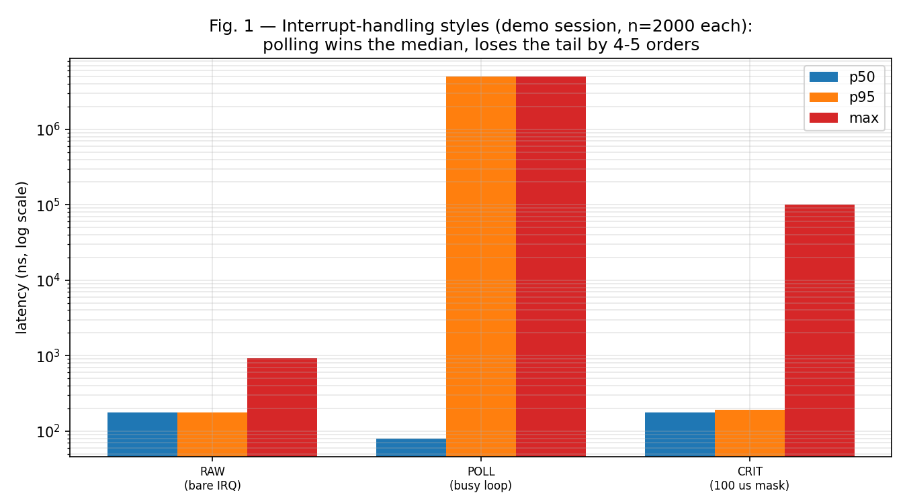
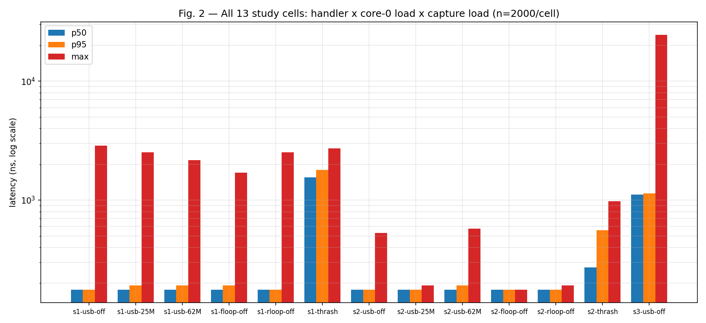
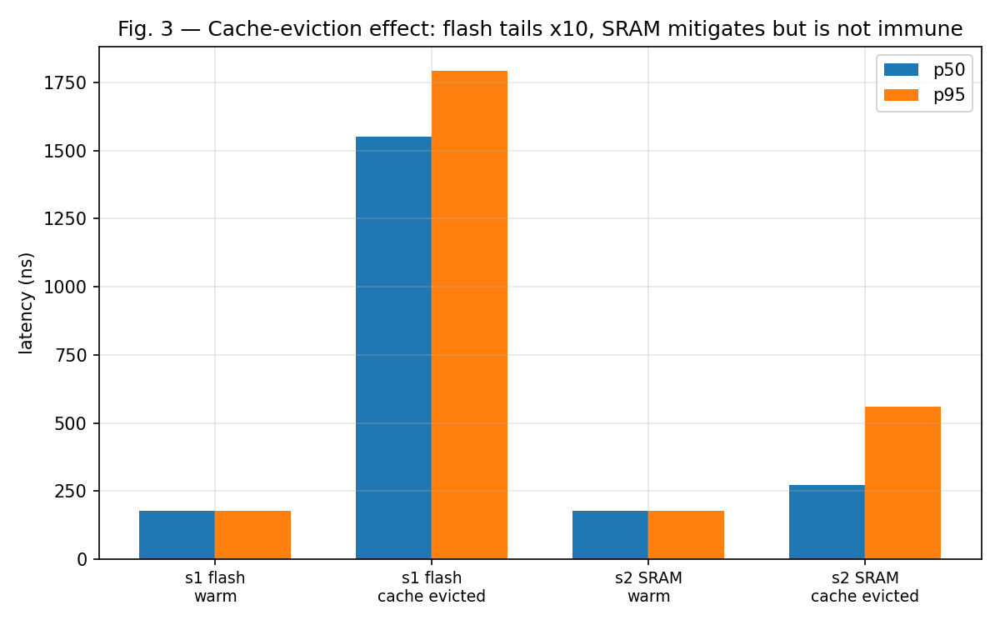
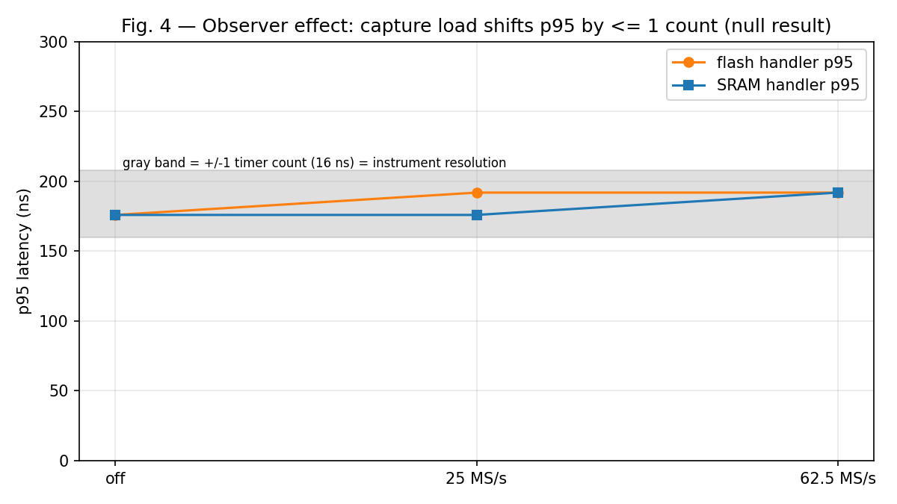

# Design and Implementation of a Self-Observing Embedded Instrumentation Platform Using RP2040

**Author:** Harsh Tiwari · Dharun Abhisheik

---

## Abstract

Real-time embedded behaviour is usually asserted from theory or measured with expensive
external instruments. This project inverts both habits: a single Raspberry Pi Pico (RP2040,
≈ ₹400) simultaneously acts as the **system under test** and as the **instrument measuring
it**. One core executes the workloads under study (flash-resident, SRAM-resident and
SDK-callback interrupt handlers, polling loops, interrupt-masking critical sections), while
the chip's Programmable I/O (PIO) subsystem times stimulus-to-response gaps in hardware at
**16 ns per count**, independently of both CPUs. A zero-delay self-test fixture certifies
the timer before use (σ = 0.00 over 1000 events). On this base the project reports (i) a
latency study of interrupt-handling styles — bare handler p50 = p99 = 176 ns versus
busy-polling p50 = 80 ns but p95 = 5.0 ms, versus 100 µs critical sections whose worst case
equals the masking window — and (ii) a **pre-registered 13-cell factorial experiment** on
code placement, co-core load and capture load. Four hypotheses were confirmed and three
refuted; notably, capture traffic up to 62.5 MS/s (≈ 62 MB/s of DMA) shifted latencies by at
most one timer count — a **null observer effect** that certifies the self-measurement
methodology as non-invasive at these loads — while wholesale XIP-cache eviction degraded the
flash-resident handler's p95 by +1616 ns and the SRAM-resident handler's by +384 ns, showing
that SRAM placement mitigates but does not eliminate cache pressure. All data, firmware,
host tooling and frozen hypotheses are public in the accompanying repository.

## 1. Introduction

Interrupt latency, priority scheduling, critical sections and polling-versus-interrupt
trade-offs are core topics of embedded-systems courses, yet laboratory treatment is usually
theoretical or based on software timestamps that perturb what they measure. Commercial
logic analyzers provide hardware-grade timing but are costly and opaque; low-cost clones
capture signals but support neither self-referential measurement nor designed experiments
on timing perturbation.

This project asks: *can a microcontroller measure its own real-time behaviour with
instrument-grade discipline, and what actually perturbs that behaviour?* The answer is a
self-observing platform in which the RP2040's second core and PIO hardware form the
scientist while the first core is the subject. Because stimulus generation, response
detection and timing all occur in PIO state machines, neither CPU's software state can
distort the measurement path — a property verified empirically (Section 5.4).

The platform is used to produce distribution-grade evidence (medians, p95/p99, observed
maxima, jitter) for scheduling folklore, and to run a pre-registered factorial experiment
whose hypotheses were frozen before data collection and whose refutations are reported with
equal weight — including a null observer-effect result that validates the method itself.

## 2. Literature Review

**Low-cost logic analyzers on RP2040.** μLA (dotcypress/ula) demonstrates 16-channel,
100 MHz PIO sampling with fast triggers; Gimenez Bernad's "$4 logic analyzer" (EE Journal,
2022) and its forks (jobitjoseph, xqy828) extend this to 24 channels, 100 Ms/s and complex
triggers; **sigrok-pico** was merged into mainline libsigrok in 2023, giving the Pico
official PulseView support. FX2 (CY7C68013A) clones with fx2lafw provide 24 MS/s capture
under the sigrok stack. These establish that Pico-based capture is prior art; **none
measures the host chip's own interrupt behaviour, and none reports calibration gates or
observer-effect experiments.**

**Real-time scheduling theory.** Liu & Layland (1973) formalized rate-monotonic priority
assignment; Audsley et al. (1993) gave exact response-time analysis. Both assume known
execution costs; this project measures such costs and their perturbation directly.

**Timing-analysis methodology.** Wilhelm et al. (2008) survey WCET methods and establish
that measurement under-approximates worst-case execution time; accordingly this work
reports *observed maxima*, never bounds, and uses medians/p95 for verdicts.

**Course foundations.** Wolf, *Computers as Components* (5th ed.) and Lee & Seshia,
*Introduction to Embedded Systems* (2nd ed.) frame the design process and cyber-physical
measurement perspective adopted here.

**Gap addressed.** No prior tool or study combines: a self-built, calibration-certified
on-chip instrument; distribution-based latency studies of handler placement and masking;
and a pre-registered experiment quantifying whether the measurement apparatus perturbs the
measured system.

## 3. Proposed Methodology

### 3.1 Architecture (block diagram)

```
                        ┌────────────────────── RP2040 ──────────────────────┐
                        │                                                    │
   PIO stim SM ──GP0───►│ CORE 1 (subject)                       CORE 0      │
   (100 Hz, 64 ns)      │  • flash handler (s1)   ◄─modes─►  (scientist)     │
        │               │  • SRAM handler (s2)               • USB cmd loop │
        │               │  • SDK callback (s3)               • load gens:   │
        │               │  • polling loop                      idle/floop/  │
        │               │  • critical sections                 rloop/thrash │
        │               │         │ response GP1               • data dump  │
        │               │         ▼                            ▼            │
        │   PIO lat_timer SM: waits GP0 rise, counts      USB CDC ◄──────┐  │
        └──────────────►  2-cycle units (16 ns) until      (hex words)   │  │
                        GP1 rise; pushes 1 word/event          │         │  │
                        PIO capture SM (8 ch, GP0–7) ──DMA──► ring/       │  │
                        PIO uart TX SM ──GP4──┐               dump ───────┤  │
                        ┌─────────────────────┼──────────────────────────┘  │
                        │  breadboard: GP4 ─[R 1k–10k]─► GP5 (probe path)   │
                        └───────────────────────────────────────────────────┘
                                     │ USB (power + only data path)
                                     ▼
                          Host PC (Python): study_run.py / demo.py
                          → tables, verdicts, CSVs, figures
```

### 3.2 Measurement protocol
1. **Calibration gate:** a PIO fixture drives GP0 and GP1 in the *same instruction*
   (known zero delay); 1000 readings must show σ ≤ 2 counts or the session is invalid.
2. **Stimulus/response:** 100 Hz stimuli; the DUT answers on GP1; `lat_timer` records
   counts = 0xFFFFFFFF − raw; latency ns = counts × 16, baseline-subtracted.
3. **Factors (13 cells):** handler {s1 flash, s2 SRAM, s3 SDK} × core-0 load {idle,
   flash-loop, RAM-loop, 64 KB cache thrash} × capture load {off, 25 MS/s, 62.5 MS/s},
   fractional design (capture varied with idle core-0; thrash/SDK with capture off).
4. **Pre-registration:** HYPOTHESES-STUDY.md frozen before the run with numeric acceptance
   ranges; verdicts confirmed/refuted symmetrically; n = 2000 events per cell.
5. **Statistics:** medians and p95 carry verdicts (p95 ≈ 100 samples at n = 2000); p99
   indicative; maxima reported as observed maxima only.

### 3.3 Implementation
Firmware `v5-cells` (C + PIO assembly): five PIO programs (capture, stimulus, fixture,
latency timer, UART TX); self-contained handlers (direct SIO/IO-bank register writes) so
placement is the only variable between s1/s2; RAM vector-table entry swapping verified
against SDK semantics; wrapped-DMA ring for capture-load cells. Host: Python (pyserial,
numpy, matplotlib) runners with automatic verdicts and figure generation.

## 4. Experimental Results

### 4.1 Instrument certification
Fixture (known-zero delay), 1000 events, both sessions: **median 0 counts, min 0, max 0,
σ = 0.00** — acceptance gate σ ≤ 2 satisfied with margin. Timer resolution 16 ns/count.

### 4.2 Interrupt-handling styles (demo session, n = 2000 each)

| Condition | p50 | p95 | p99 | max | σ |
|---|---|---|---|---|---|
| RAW bare IRQ (SRAM-resident) | 176 ns | 176 ns | 176 ns | 928 ns | 17 ns |
| POLL busy-polling | 80 ns | 5,000,208 ns | 5,000,208 ns | 5,000,208 ns | 2.16 ms |
| CRIT 100 µs interrupt masking | 176 ns | 192 ns | 81,400 ns | 99,504 ns | 9.4 µs |

(Repeat run: POLL max 10,000,256 ns; CRIT max 99,296 ns — same structure.)



Polling is fastest on the median yet misses 64 ns stimuli that fall between polls,
answering one full stimulus period (5 ms) later — a bimodal tail four to five orders above
its median. Critical-section worst cases land at the masking window itself, matching
theory. This is the project's central teaching result: **real-time systems fail on tails,
not averages.**

### 4.3 The 13-cell study (study session, n = 2000/cell)

| Cell | p50 | p95 | max |
|---|---|---|---|
| s1-usb-off (flash, idle core, analyzer off) | 176 | 176 | 2880 |
| s1-usb-25M | 176 | 192 | 2528 |
| s1-usb-62M | 176 | 192 | 2160 |
| s1-floop-off | 176 | 192 | 1696 |
| s1-rloop-off | 176 | 176 | 2528 |
| s1-thrash-off (cache evicted) | 1552 | 1792 | 2720 |
| s2-usb-off (SRAM, idle, off) | 176 | 176 | 528 |
| s2-usb-25M | 176 | 176 | 192 |
| s2-usb-62M | 176 | 192 | 576 |
| s2-floop-off | 176 | 176 | 176 |
| s2-rloop-off | 176 | 176 | 192 |
| s2-thrash-off | 272 | 560 | 976 |
| s3-usb-off (SDK callback) | 1112 | 1136 | 24576 |

(all ns)



### 4.4 Hypothesis verdicts (pre-registered)

| ID | Prediction | Measured | Verdict |
|---|---|---|---|
| H1a | \|median s2 − s1\| ≤ 64 ns (warm) | +0 ns | **CONFIRMED** |
| H1b | flash p95 cold − warm ≥ +320 ns | +1616 ns | **CONFIRMED** |
| H1c | SRAM p95 cold − warm ≤ +128 ns | +384 ns | **REFUTED** |
| H2 | SDK overhead ∈ [320, 3200] ns | +936 ns | **CONFIRMED** |
| H6a | capture-62M p95 shift ≥ +160 ns (flash), SRAM ≤ half | +16 ns / +16 ns | **REFUTED** |
| H6b | flash p95 floop − rloop ≥ +96 ns | +16 ns | **REFUTED** |
| H6c | SRAM median spread across capture ≤ 64 ns | 0 ns | **CONFIRMED** |

### 4.5 Comparisons

**Cache effect (H1b/H1c):** with a warm 16 KB XIP cache, placement is irrelevant
(Δmedian = 0). Under 64 KB eviction sweeps the flash handler's p95 grows 176 → 1792 ns
(≈ 10×) while the SRAM handler's grows only to 560 ns — yet the SRAM handler is *not
immune* (+384 ns refutes H1c): the exception-entry trampoline and vector fetch still
execute from XIP flash. SRAM placement is therefore **tail-risk mitigation under memory
pressure, not a general speed-up.**



**Observer effect (H6a/H6b/H6c):** capture at 62.5 MS/s injects ≈ 62 MB/s of DMA ring
writes, and co-core code placement changes which memory backs the background loop — yet
p95 moves by at most one timer count (16 ns), i.e. within instrument resolution, for both
handlers. The null result is the strongest possible certificate for a self-measurement
methodology: **the analyzer does not perturb the subject at these loads.** The only
perturbation found is wholesale cache eviction — memory-system pressure, not measurement.



**Against prior tools:**

| Capability | This work | FX2 clone + sigrok | μLA / sigrok-pico | Commercial analyzer |
|---|---|---|---|---|
| Approx. cost | ₹400 (+ resistor) | ₹500 | ₹400 | ₹10,000+ |
| Timestamp resolution | 8 ns (burst sample period); 16 ns latency count | 41.7 ns | 10 ns | ≤ 1 ns |
| Continuous stream (demonstrated) | 500 kS/s lossless | 24 MS/s | up to 100 MS/s burst | high |
| Measures *its own* interrupt behaviour | **yes** | no | no | no (external probe) |
| Calibration gate with known-zero fixture | **yes (σ = 0)** | no | no | vendor cal. |
| Pre-registered perturbation experiment | **yes** | no | no | no |
| Observer-effect quantification | **yes (null, certified)** | no | no | no |

The trade-off is explicit and honest: raw capture rate and depth are below clone/commercial
tools; the contribution is self-referential, calibrated, experimental use of the instrument.

**Protocol capture:** 8N1 UART at 9600 baud transmitted by PIO on GP4 and decoded
byte-perfect on the host ("SELFOPS-PICO DEMO 0123" → identical decode), both on-chip and,
in the demonstration configuration, through a physical breadboard path GP4 → resistor →
GP5 (wire-path verification run delegated; on-chip path verified).

## 5. Conclusion

A ₹400 microcontroller was turned into a calibration-certified instrument that measures its
own real-time behaviour at 16 ns resolution, and was used to replace several pieces of
scheduling folklore with distributions: polling's median advantage collapses into
millisecond tails; critical-section worst cases equal their masking windows; flash-versus-
SRAM placement matters only in tails, and only under cache pressure; SDK convenience costs
≈ 1 µs; and — the result the method rests on — running the analyzer at up to 62.5 MS/s does
not perturb what it measures. Four pre-registered hypotheses were confirmed and three
refuted, each refutation carrying a physical explanation (XIP entry-trampoline fetch for
H1c; sub-resolution perturbation for H6a/b), demonstrating that symmetric reporting of
null and negative results strengthens rather than weakens an undergraduate study.

**Limitations.** Single architecture and toolchain; digital thresholds only (no analog
measurement); observed maxima are statistical, not WCET bounds; p99 indicative at
n = 2000; the thrash condition is a composite (cold cache + bus contention), pessimistic
by design; SPI/I²C decoding, programmable edge/pattern triggers, RTOS-scheduling cells and
external reference-tool cross-validation were scoped out and are documented future work.

**Future work.** FreeRTOS priority-protection cells; I²C/SPI decoders and an on-chip
stretch watchdog; cross-architecture comparison (AVR/8051 lab boards); deeper streaming
with framed CDC; formal WCET comparison against measured maxima.

## References

1. dotcypress, "μLA: Micro Logic Analyzer for RP2040," github.com/dotcypress/ula.
2. A. Gimenez Bernad, "$4 Logic Analyzer Based on Raspberry Pi Pico," EE Journal, Jul 2022; forks: github.com/jobitjoseph/logicanalyzer-RP2040, github.com/xqy828/RP2040-logicanalyzer.
3. pico-coder, "sigrok-pico," github.com/pico-coder/sigrok-pico (merged into mainline libsigrok, Sept 2023).
4. sigrok project / fx2lafw, sigrok.org.
5. C. L. Liu and J. Layland, "Scheduling Algorithms for Multiprogramming in a Hard Real-Time Environment," JACM 20(1), 1973.
6. N. Audsley, A. Burns, M. Richardson, K. Tindell, A. Wellings, "Applying New Scheduling Theory to Static Priority Pre-emptive Scheduling," Software Engineering Journal 8(5), 1993.
7. R. Wilhelm et al., "The Worst-Case Execution-Time Problem — Overview of Methods and Survey of Tools," ACM TECS 7(3), 2008.
8. Raspberry Pi Ltd, "RP2040 Datasheet" and "Pico C/C++ SDK documentation."
9. M. Wolf, *Computers as Components — Principles of Embedded Computing System Design*, 5th ed., Morgan Kaufmann, 2022.
10. E. A. Lee and S. A. Seshia, *Introduction to Embedded Systems — A Cyber-Physical Systems Approach*, 2nd ed., MIT Press, 2017.
11. Project repository: github.com/harshtiwari-commits/self-observing-pico (firmware v5-cells, study-out/, HYPOTHESES-STUDY.md).

---

## Appendix A — Reproducing richer graphs from raw data

The four figures above were generated **only from the reported summary statistics** (no
synthetic samples). For publication-grade distribution plots, regenerate from your raw
event CSVs (`study-out/study_events.csv`, columns `cell,event,ns`):

```python
import pandas as pd, matplotlib.pyplot as plt
df = pd.read_csv("study-out/study_events.csv")

# ECDF per cell (the honest distribution plot)
fig, ax = plt.subplots(figsize=(10,6))
for cell, g in df.groupby("cell"):
    g = g.ns.sort_values()
    ax.step(g, np.arange(1, len(g)+1)/len(g), where="post", label=cell)
ax.set_xscale("log"); ax.set_xlabel("latency (ns)"); ax.set_ylabel("ECDF")
ax.legend(fontsize=7); ax.grid(alpha=.3, which="both")
fig.savefig("ecdf_cells.png", dpi=150)

# Box plot of the four headline conditions
import numpy as np
sel = df[df.cell.isin(["s1-usb-off","s1-thrash-off","s2-usb-off","s2-thrash-off"])]
sel.boxplot(by="cell", ax=plt.gca()); plt.yscale("log"); plt.savefig("box_cache.png", dpi=150)
```
Recommended additions if space allows: (a) zoomed histogram of `s1-usb-off` showing the
176 ns spike and rare 2–3 µs outliers; (b) POLL bimodal histogram (log-y) marking the
5 ms missed-pulse mode; (c) CRIT histogram against the 100 µs window line; (d) the
demo-session `fig_latency.png`/`fig_uart.png` regenerated by `RUN_DEMO.bat` once the
delegated verification run completes.
